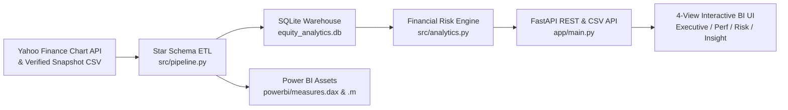
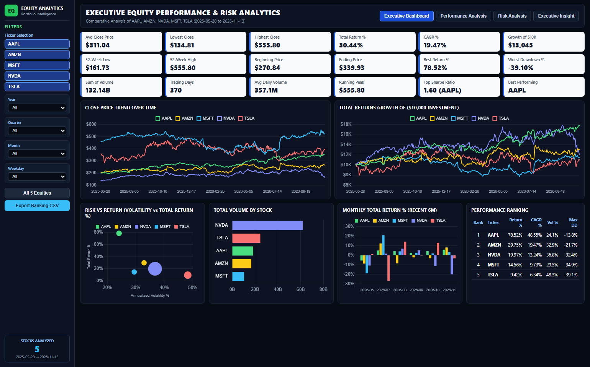
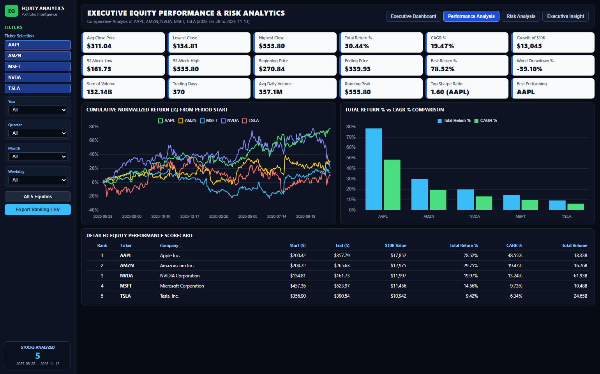
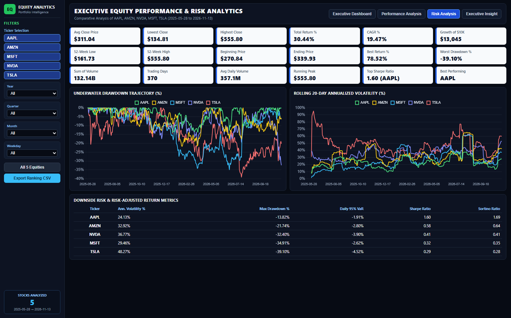

# Executive Equity Performance & Risk Analytics

**Enterprise Business Analysis · Financial Analytics · Portfolio Risk Intelligence**


> A four-view Executive Equity Performance & Risk Analytics platform evaluating **AAPL**, **AMZN**, **MSFT**, **NVDA**, and **TSLA** across 370 real trading days (`2025-05-28` to `2026-11-13`) with reconciled Total Return %, CAGR %, standardized `$10,000` investment growth, annualized volatility, maximum drawdown, 95% daily VaR, Sharpe Ratio, and Sortino Ratio.

---

## 1. Executive Summary

Evaluating large-cap equities across shifting market cycles requires uniting cumulative returns with downside risk metrics under strict calculation governance. Fragmented market spreadsheets frequently suffer from inconsistent return formulas, mismatched date calendars, and disconnected volatility metrics.

**Executive Equity Performance & Risk Analytics** consolidates genuine historical daily OHLCV market data from Yahoo Finance into a validated `SQLite` star schema, enforces mathematical reconciliation across Python, SQL, and Power BI DAX semantics, and delivers a **four-view interactive web BI application** (`Executive Dashboard`, `Performance Analysis`, `Risk Analysis`, and `Executive Insight`) paired with complete Business Analysis governance artifacts.

---

## 2. Business Problem Statement

Investment and executive stakeholders struggle when return, volume, and volatility reporting operate independently:
- **Inconsistent Return Conventions:** Discrepancies between simple returns, trading-day vs. calendar-day CAGR, and unaligned trading windows distort rankings.
- **Risk Blindness:** Headline gains conceal severe interim drawdowns and elevated return volatility.
- **Validation Gaps:** Unreconciled dashboard numbers undermine executive confidence in portfolio reviews.

---

## 3. Project Objectives

- **BO-01:** Consolidate 370 aligned trading days (`1,850` daily observations) for `AAPL`, `AMZN`, `MSFT`, `NVDA`, and `TSLA`.
- **BO-02:** Reconcile Total Return %, CAGR % (252 trading-day convention), and standardized `$10,000` investment growth trajectories.
- **BO-03:** Quantify risk via Annualized Volatility %, Maximum Drawdown %, Daily 95% VaR, Sharpe Ratio, and Sortino Ratio.
- **BO-04:** Provide 4 interactive analytical views (`Executive Dashboard`, `Performance Analysis`, `Risk Analysis`, `Executive Insight`).
- **BO-05:** Enable dynamic multi-ticker chip selection and calendar filtering (`Year`, `Quarter`, `Month`, `Weekday`) with full test coverage.

---

## 4. Proposed Solution & Reconciled Market Findings

### Observed 370-Day Performance & Risk Scorecard (`2025-05-28` to `2026-11-13`, Real Yahoo Finance Data)

| Rank | Ticker | Company | Total Return % | CAGR % | $10K End Value | Ann. Volatility % | Max Drawdown % | Sharpe Ratio |
| :---: | :--- | :--- | :---: | :---: | :---: | :---: | :---: | :---: |
| **1** | **AAPL** | Apple Inc. | `+78.52%` | `+48.55%` | `$17,852` | `24.13%` | `-13.82%` | `1.60` |
| **2** | **AMZN** | Amazon.com Inc. | `+29.75%` | `+19.47%` | `$12,975` | `32.92%` | `-21.74%` | `0.58` |
| **3** | **NVDA** | NVIDIA Corporation | `+19.97%` | `+13.24%` | `$11,997` | `36.77%` | `-32.40%` | `0.41` |
| **4** | **MSFT** | Microsoft Corporation | `+14.56%` | `+9.73%` | `$11,456` | `29.46%` | `-34.91%` | `0.32` |
| **5** | **TSLA** | Tesla, Inc. | `+9.42%` | `+6.34%` | `$10,942` | `48.27%` | `-39.10%` | `0.29` |

- **Equal-Weight Composite:** `+30.44%` Total Return, `+19.47%` CAGR, `$13,045` composite `$10K` ending value, `132.14B` cumulative share volume (`357.1M` avg daily volume across the 5 equities).
- **Risk-Adjusted Leader:** **AAPL** delivered the highest total return (`+78.52%`) with the lowest annualized volatility (`24.13%`), shallowest maximum drawdown (`-13.82%`), and strongest Sharpe Ratio (`1.60`).

---

## 5. Methodology & Implementation Approach

1. **Data Acquisition & Offline Fallback (`src/pipeline.py`):** Queries Yahoo Finance's public chart API (`query1.finance.yahoo.com`) on `--refresh`, aligns common trading dates across all 5 equities (`370` days), and persists `data/raw/equity_prices_snapshot.csv` for deterministic offline execution.
2. **Exact Financial Mathematics (`src/analytics.py` & `powerbi/measures.dax`):**
   - `Total Return = (P_end - P_start) / P_start`
   - `CAGR = (P_end / P_start)^(252 / (N - 1)) - 1`
   - `Annualized Volatility = std(r_daily, ddof=1) * sqrt(252)`
   - `Max Drawdown = min((P_t - RunningPeak_t) / RunningPeak_t)`
   - `Sharpe Ratio = (mean(r_daily) * 252 - 0.04) / Annualized Volatility`
3. **Quality Fixes Over Spec Baseline:** Corrected screenshot label typos (`&TELA` → `& TSLA`, `2025-20260` → dynamically calculated span) and implemented automated `pytest` assertions verifying mathematical reconciliation.

---

## 6. Key Features & Capabilities

- **4 Dedicated Interactive Views:** Seamless switching across Executive Dashboard, Performance Analysis, Risk Analysis, and Executive Insight.
- **18 Executive KPI Cards:** Close, Low/High, 52-Week Low/High, Beginning/Ending, Total Return %, CAGR %, Growth of $10K, Best Return %, Worst Drawdown %, Volume, Trading Days, Running Peak, Top Sharpe, and Best Performer.
- **Interactive Multi-Ticker Chips & Calendar Slicers:** Toggle any combination of AAPL, AMZN, MSFT, NVDA, TSLA plus Year, Quarter, Month, and Weekday filters.
- **Risk Analytics Suite:** Underwater drawdown curves, rolling 20-day annualized volatility, 95% daily VaR, Sharpe & Sortino tables.
- **CSV Export & Input Validation:** Download filtered equity rankings (`/api/export/ranking-csv`) with HTTP 400 checks for unknown tickers.

---

## 7. Technology Stack

| Layer | Technologies Used |
| :--- | :--- |
| **Backend & API** | Python 3.13, FastAPI, Uvicorn, Pydantic |
| **Market Ingestion & Math** | Yahoo Finance API (`urllib`), SQLite, Pandas, NumPy, SciPy |
| **Interactive Frontend** | HTML5, CSS3, Vanilla JS, Chart.js 4.4.7 (vendored) |
| **BI Reference Layer** | Power BI DAX (`measures.dax`), Power Query M (`power_query.m`) |
| **BA Deliverables & QA** | OpenPyXL (`.xlsx`), ReportLab (`.pdf`), Mermaid, Pytest |

---

## 8. Architecture & Workflow



---

## 9. Project Structure

```text
executive-equity-performance-risk-analytics/
├── app/                             # FastAPI backend + 4-view interactive Chart.js UI
├── assets/screenshots/              # Captured Executive, Performance & Risk views
├── data/
│   ├── raw/equity_prices_snapshot.csv   # Verified 370-day Yahoo Finance daily OHLCV snapshot
│   └── processed/                   # Star schema CSV exports
├── docs/business-analysis/          # 8 BA docs + rtm_workbook.xlsx + uat_test_log.xlsx + PDF
├── powerbi/                         # data_model.md, measures.dax, power_query.m
├── sql/                             # schema.sql, analytics_queries.sql
├── src/                             # config.py, pipeline.py, analytics.py, ba_artifacts.py
├── tests/test_project.py            # Automated formula reconciliation & API tests
├── pytest.ini
├── requirements.txt
└── run.py
```

---

## 10. Installation & Setup

```bash
git clone https://github.com/abrahamnewwine-web/executive-equity-performance-risk-analytics.git
cd executive-equity-performance-risk-analytics
python -m venv .venv
# Windows: .venv\Scripts\activate | macOS/Linux: source .venv/bin/activate
pip install -r requirements.txt
```

---

## 11. Usage Instructions

```bash
# Build warehouse & BA deliverables using bundled snapshot
python run.py --build-only

# Refresh live Yahoo Finance market data & build
python run.py --build-only --refresh

# Launch 4-view interactive dashboard (default port 8003)
python run.py --port 8003

# Run reconciliation and API test suite
pytest -v
```

---

## 12. Screenshots & Visual Documentation

### View 1: Executive Dashboard


### View 2: Performance Analysis


### View 3: Risk Analysis (Drawdowns & Rolling 20-Day Volatility)


---

## 13. Video Demonstration

Video Demonstration: Coming Soon.

---

## 14. Deliverables

- **Market Pipeline & SQL Schema:** [`src/pipeline.py`](src/pipeline.py), [`sql/schema.sql`](sql/schema.sql), [`sql/analytics_queries.sql`](sql/analytics_queries.sql)
- **4-View Interactive App:** [`app/main.py`](app/main.py), [`app/templates/index.html`](app/templates/index.html)
- **Power BI Developer Suite:** [`powerbi/data_model.md`](powerbi/data_model.md), [`powerbi/measures.dax`](powerbi/measures.dax), [`powerbi/power_query.m`](powerbi/power_query.m)
- **Business Analysis Suite:**
  - [01 — Business Case](docs/business-analysis/01-business-case.md) · [02 — BRD](docs/business-analysis/02-brd.md) · [03 — Stakeholder & RACI](docs/business-analysis/03-stakeholder-raci.md)
  - [04 — AS-IS / TO-BE Process Maps](docs/business-analysis/04-process-mapping-gap-analysis.md)
  - [05 — RTM](docs/business-analysis/05-requirements-traceability-matrix.md) & [`rtm_workbook.xlsx`](docs/business-analysis/rtm_workbook.xlsx)
  - [06 — Agile Backlog](docs/business-analysis/06-agile-epics-user-stories.md) · [07 — UAT Plan & Defect Log](docs/business-analysis/07-uat-test-plan-and-defect-log.md) & [`uat_test_log.xlsx`](docs/business-analysis/uat_test_log.xlsx)
  - [08 — Executive Insights](docs/business-analysis/08-executive-insights-recommendations.md) & [`executive_insights_report.pdf`](docs/business-analysis/executive_insights_report.pdf)

---

## 15. Business Value & Impact

- **Observed Analytical Value:** Replaces ad hoc market spreadsheets with a mathematically reconciled 5-equity risk/return workbench uniting `$10K` trajectories, CAGR, drawdowns, and Sharpe/Sortino evaluation.
- **Expected Strategic Benefits:** Enables portfolio reviewers to evaluate return quality relative to downside volatility rather than chasing unadjusted price appreciation.

---

## 16. Testing & Validation

All 5 automated pytest tests verify 370-day dataset alignment (`1,850` rows), exact algebraic reconciliation of Total Return %, CAGR %, and `$10K` endings, risk invariants (`Volatility > 0`, `Max Drawdown <= 0`, `VaR < 0`), descending ranking order, HTTP 400 validation, CSV export, and BA workbook/PDF generation.

---

## 17. Limitations & Future Enhancements

- **Scope Disclaimer:** Historical analytics only; does not represent investment advice or guarantee future returns.
- **Future Enhancements:** Custom portfolio weight allocation optimizer (mean-variance frontier), correlation matrix heatmap, and benchmark S&P 500 (`SPY`) alpha/beta attribution.

---

## 18. Author Information

**Abraham Adetola** — *PMP® | PMI-PBA® | CSPO® | CSM®*  
Business Intelligence & Business Analyst Professional · Atlanta, Georgia, USA  
Email: [abrahamnewwine@gmail.com](mailto:abrahamnewwine@gmail.com)
